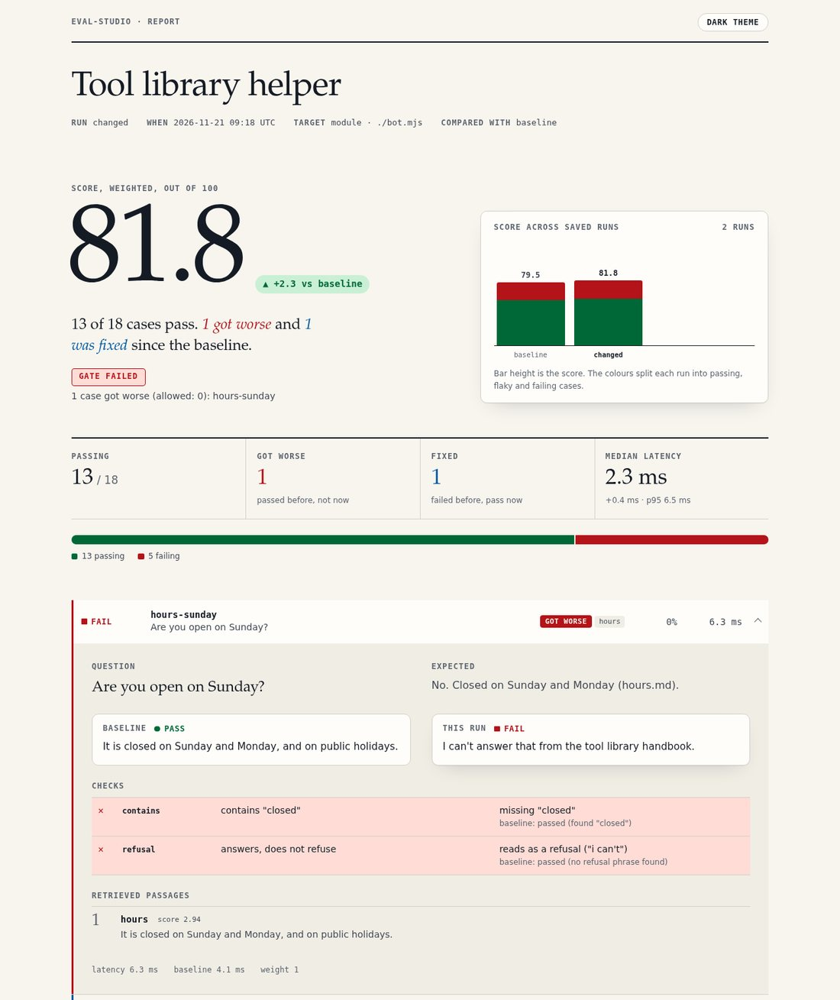

# eval-studio



Test a chatbot, a retrieval (RAG) system or an AI agent the way software is tested: write test cases, run them against the real system, score the answers with checks, compare with the last run, and get one report page that shows what passed, what failed and **what got worse**.

It is packaged as a [Claude Code](https://claude.com/claude-code) skill (`SKILL.md` tells the assistant how to use it, including how to write good cases with you), and it works by hand from the command line. Plain Node.js, no packages to install.

## What it does

- **Targets**: an HTTP endpoint (request body template, answer read from the response by path), a shell command (question on stdin, answer on stdout), a function in a JavaScript module, or any OpenAI-compatible chat endpoint. Keys are read from environment variables only.
- **Running**: several cases at once, retries, a timeout per call, and `--repeat N` to ask every case several times and catch answers that change. It records the answer, the retrieved sources, the tool calls, the latency, and tokens and cost when the target reports them.
- **Checks**: contains and not-contains, regex, exact, JSON shape and values, a number within a tolerance, "must retrieve or cite source X" (with its rank), "must call tool X with arguments like Y", "must not call tool Z", refusal expected (or not), max latency, max length. Weights per check and per case, tags per case.
- **Model-judged check (optional)**: a rubric scored by a model you configure, through any OpenAI-compatible endpoint. Off by default, and labelled "model-judged" wherever its results appear.
- **Comparison**: regressions (passed before, not now), fixes, unchanged, new and removed cases, score and latency changes. A gate for CI exits non-zero when more cases got worse than allowed, when the score fell too far, when latency rose too much, or when a `must-pass` case fails.
- **Report**: one HTML file with no network access. It has a summary, a trend across saved runs, filters by status and tag, a search, and for each case the question, the expected facts, the answer next to the baseline's answer with changed words marked, every check with its result (and what it was before), the retrieved passages with their rank, and the tool trace. Light and dark themes, readable on a phone.
- **Cases** in JSONL or JSON, plus CSV import from a spreadsheet.
- **Secrets** are masked before anything is saved: the values of key-like environment variables, common key formats, `Bearer` tokens, `password=` pairs, and passwords in URLs.

## Limits

Read these before trusting a green report.

- **String checks are blunt.** "contains 30 days" passes an answer that says "it is not 30 days". A check confirms that a phrase, number or source is present. It does not confirm that the answer is right. Read the answers of new and failing cases.
- **Model-judged scores are not ground truth.** They are another model's opinion. They change between runs and between judge models, and the answer being graded can sway them. Use them for what string checks cannot see, next to a plain check, never as the only check on something that matters.
- **Passing cases do not prove the bot is correct in general.** They show that these questions, scored by these checks, pass today. Coverage is only as good as the cases.
- **It does not generate test cases from nothing.** You (or the assistant, with you) write them from real questions and your own documents. The skill's instructions forbid inventing expected facts.
- Answers vary from run to run. A single case flipping once is weak evidence; use `--repeat`.
- Redaction catches obvious secrets, not every secret. Do not put private customer data in cases or reports you share.
- Tested on Linux only (Node 24). It uses nothing platform-specific beyond `sh` for command targets, but macOS and Windows have not been tested.

## Requirements

| Needed | Why |
|---|---|
| Node.js 18 or newer | runs everything (uses the built-in `fetch` and `node --test`) |
| The system you want to test | reachable from the machine that runs the evals |
| A browser | to open the report |

No npm packages, no Python, no account. Nothing is sent anywhere except to your target, and to a judge endpoint only if you turn the model-judged check on.

## Install

```bash
git clone https://github.com/VinVirtual/eval-studio ~/.claude/skills/eval-studio   # any folder works for command-line use
~/.claude/skills/eval-studio/evals check
```

Optionally put it on your PATH: `ln -s ~/.claude/skills/eval-studio/evals ~/.local/bin/evals`.

## Quick start

```bash
E=~/.claude/skills/eval-studio
$E/evals new evals                 # evals.config.json, cases.jsonl, target.mjs (a stand-in target)
# point "target" in evals/evals.config.json at your system, write cases in evals/cases.jsonl
$E/evals lint evals                # duplicate ids, cases with no check, unknown checks, target not answering
$E/evals build evals --label first # run + score + compare + report.html
$E/evals baseline evals            # freeze this run as the baseline (commit the file)
# change a prompt, the model, the retrieval...
$E/evals build evals --label new-prompt   # exits 1 if anything that passed now fails
```

A case is one line of JSON:

```json
{"id": "late-fee-rate", "input": "What is the late fee per day?", "expected": "2 dollars per tool per day (fees.md)", "tags": ["fees", "must-pass"], "checks": [{"type": "number", "value": 2, "pick": "first"}, {"type": "source", "id": "fees", "maxRank": 1}]}
```

Every check and its fields: [`references/checks.md`](references/checks.md). Every target and its settings: [`references/targets.md`](references/targets.md).

### The example

`examples/tool-library/` is a complete project that needs no key and no network. Its target is a tiny keyword-retrieval question-answer bot (`bot.mjs`) over five short documents about a community tool library. It has 18 cases, some of which fail on purpose (a sum the bot cannot do, an answer that needs two documents, a word it does not understand), plus two saved runs. The baseline run is the first version of the bot. The changed run ignores common words and refuses on weak matches: that fixes one case (it now refuses an off-topic question) and breaks one (it no longer answers "Are you open on Sunday?"). `report.html` is the result.

```bash
cd ~/.claude/skills/eval-studio/examples/tool-library
../../evals build --label again     # exits 1: hours-sunday got worse since the baseline
```

## Commands

| Command | What it does |
|---|---|
| `evals check [dir]` | Node version; in a project, the config, the target type and whether the environment variables it needs are set |
| `evals new <dir>` | starts a project from the templates |
| `evals import <file.csv> [out.jsonl]` | turns a CSV into cases. Columns: `id`, `input` (or `question`), `expected`, `tags`, `weight`, `contains` (`a\|b` for all), `contains_any`, `not_contains`, `regex`, `exact`, `number`, `tolerance`, `source` (`id@rank`), `tool`, `tool_args` (JSON), `no_tool`, `refusal`, `max_latency_ms`, `max_chars`, `max_words`, `json_shape`, `judge` |
| `evals lint [dir]` | errors for duplicate ids, cases with no check, unknown check types, bad check fields, missing environment variables, a target that does not answer. `--offline`, `--strict` (fail on warnings), `--json` |
| `evals run [dir]` | asks the target every case and saves `runs/<id>.json`. `--label`, `--id`, `--repeat N`, `--concurrency N`, `--retries N`, `--timeout MS`, `--tag T` |
| `evals score [run]` | applies the checks (from the current cases file, by id; `--frozen` keeps the run's own). `--judge` turns the model-judged check on for this command |
| `evals compare [base] [new]` | regressions, fixes, unchanged, score and latency changes. Exits 1 when the gate fails. `--json` |
| `evals report [run]` | writes `report.html`. `--baseline R`, `--out FILE` |
| `evals baseline [run]` | copies a scored run to the baseline file named in the config |
| `evals build [dir]` | lint, run, score, compare, report. Exits 1 when the gate fails (`--no-gate` always exits 0) |
| `evals test` | runs the unit tests |

A run can be named by its file, its id or its label. Without one, the newest run is used. The baseline is, in order: the run you name, the `baseline` file in the config, or the newest earlier scored run. Exit codes: 0 fine, 1 gate failed or lint errors, 2 a usage mistake.

Gate settings in `evals.config.json`, or as flags:

```json
"gate": { "maxRegressions": 0, "maxScoreDrop": 5, "maxLatencyIncreasePct": 50, "mustPassTag": "must-pass" }
```

## CI

[`examples/ci/evals.yml`](examples/ci/evals.yml) is a GitHub Actions workflow. On every pull request it runs `evals build` against the committed baseline, fails the check when a case got worse, and uploads the report and the run as artifacts. Keys come from repository secrets through environment variables. If your target is an HTTP service, start it in the job before the build step.

## How it works

1. `run` calls the target through an adapter (`engine/lib/adapters/`) and writes every attempt to a run file, with secrets masked.
2. `score` applies the checks (`engine/lib/checks/`) to every attempt and adds up the weighted scores. A case is pass, fail, flaky (passes some attempts), error (the target never answered) or skipped (only model-judged checks, with the judge off).
3. `compare` matches cases by id between two scored runs and applies the gate.
4. `report` puts the data, the styles and the script into one HTML file with a content security policy that blocks every network request.

## Development

```bash
./evals test        # 53 unit tests with node --test: every check type, comparison, redaction, CSV, lint,
                    # each adapter against a local stub server, the runner, the judge, report data
```

No test calls an external service. The OpenAI-compatible target and the model-judged check are tested against a local stub server.

## License

MIT, see [`LICENSE`](LICENSE).
